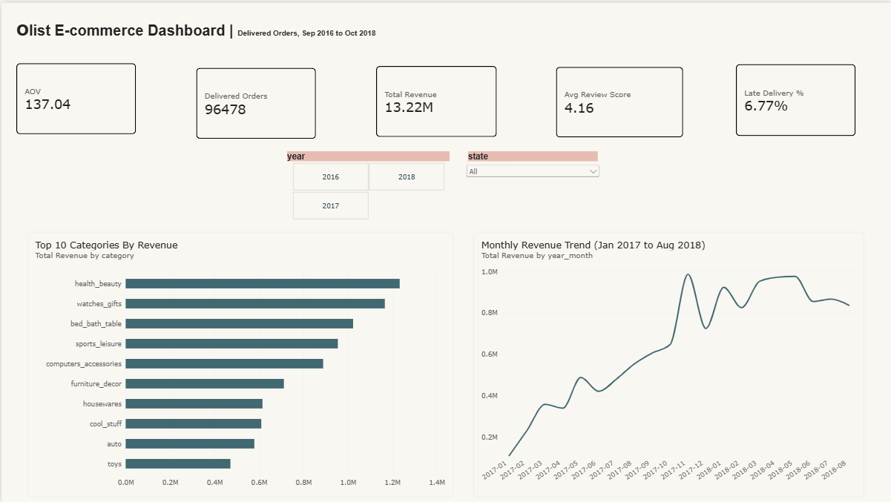
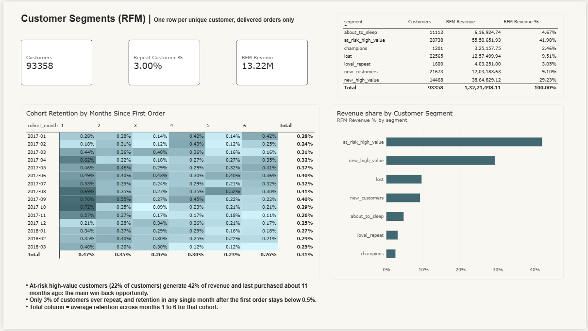
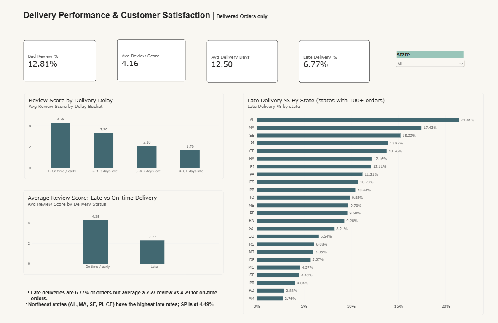
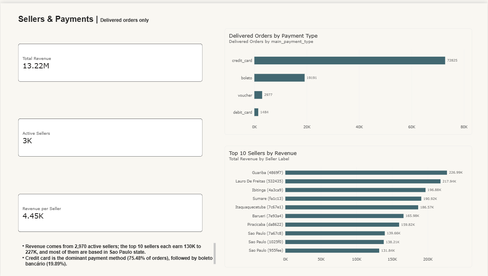

# Olist E-commerce Analysis: PostgreSQL + Power BI

End-to-end analytics project on the Olist Brazilian E-commerce dataset (~100K orders, Sep 2016 to Oct 2018). Raw CSVs were loaded into PostgreSQL, cleaned and modelled into a star schema with SQL, analysed with CTEs and window functions, and presented in a 4-page Power BI dashboard.

## Business Questions
1. How is revenue trending, and which categories and regions drive it?
2. Does late delivery hurt customer satisfaction, and by how much?
3. Who are the most valuable customers, and how many come back?
4. Which sellers and payment methods matter most?

## Tech Stack
- **PostgreSQL 18**: data loading, cleaning, star schema, analysis (CTEs, window functions, `FILTER`, `CASE`, `NTILE`)
- **Power BI Desktop**: data modelling, DAX measures, interactive dashboard
- **Git / GitHub**: version control

## Data Model
Raw tables are loaded into the `raw` schema and transformed into a star schema in the `analytics` schema.

| Table                                             | Grain                       | Purpose                                             |
|---------------------------------------------------|-----------------------------|-----------------------------------------------------|
| `fact_orders`                                     | 1 row per order             | Order status, delivery days, delay, payment, review score |
| `fact_order_items`                                | 1 row per order item        | Price, freight, product, seller                     |
| `dim_customers`,`dim_products`,`dim_sellers`,`dim_date` | 1 row per entity      | Descriptive attributes (English category names, one geolocation per zip) |
| `customer_rfm`                                    | 1 row per unique customer   | RFM scores and segments                             |
| `cohort_retention`                                | cohort month x month number | Retention %                                         |

## Key Insights
Revenue is the sum of item prices for delivered orders (freight excluded).

| # | Insight | Evidence |
|---|---|---|
| 1 | **Late delivery strongly hurts reviews** | Late orders average **2.27** vs **4.29** for on-time orders; 62.42% of late orders get a bad review (score 1 or 2) vs 9.27% |
| 2 | **Longer delays, lower scores** | 4.29 (on time), 3.29 (1-3 days late), 2.10 (4-7 days), 1.70 (8+ days) |
| 3 | **Delivery performance differs sharply by region** | Late rate: AL 21.41%, MA 17.43%, SE 15.22% vs SP 4.49%; avg delivery 24.5 days in AL vs 8.7 in SP |
| 4 | **Almost all customers buy only once** | Repeat rate is 3.00% (2,801 of 93,358 unique customers); monthly cohort retention stays below 0.5% |
| 5 | **Win-back opportunity in high-value customers** | "At-risk high-value" customers are 22% of customers but 42% of revenue (last purchase about 11 months ago) |
| 6 | **Revenue is geographically concentrated** | Sao Paulo state contributes about 38% of revenue (5.07M of 13.22M) |
| 7 | **Revenue is spread across many sellers** | 2,970 active sellers; the top seller earns 1.72% of revenue and the top 9 together 12.28% |
| 8 | **Credit card dominates payments** | 75.48% of orders by credit card (avg 3.5 installments), 19.89% by boleto (no installments) |
| 9 | **Top categories** | health_beauty (9.33%), watches_gifts (8.82%), bed_bath_table (7.74%), sports_leisure (7.22%), computers_accessories (6.72%) |

Headline KPIs: 96,478 delivered orders, 13.22M revenue, 137.04 average order value, 4.16 average review score, 12.5 average delivery days, 6.77% late deliveries.

## Dashboard
| Page | Focus |
|---|---|
|  | KPIs, monthly revenue trend, top 10 categories, year and state slicers |
|  | RFM segments, revenue share by segment, cohort retention heatmap |
|  | Late vs on-time review scores, delay buckets, late delivery % by state |
|  | Top 10 sellers by revenue, payment type split |

## Data Quality and Validation
- Row counts for all 9 tables checked against the source CSVs after loading.
- Data quality checks (missing values, duplicates, referential integrity, date logic) are in `sql/03_data_quality_checks.sql`, with findings and treatment in `data_quality_notes.md`.
- Cleaning decisions: reviews deduplicated to one per order, geolocation reduced to one row per zip code, missing product categories labelled `unknown`, categories without a translation mapped manually.
- **Reconciliation:** revenue in the analytics layer matches the raw data with zero variance, and the Power BI measures were reconciled against SQL query outputs (revenue, orders, AOV, review score, late %, repeat rate, segment and payment breakdowns).

## Repository Structure
```
olist-ecommerce-analysis/
├── README.md
├── data_quality_notes.md
├── sql/
│   ├── 01_create_tables.sql
│   ├── 02_load_data.psql
│   ├── 03_data_quality_checks.sql
│   ├── 04_star_schema.sql
│   ├── 05_business_analysis.sql
│   └── 06_rfm_and_cohort.sql
├── powerbi/
│   ├── olist_dashboard.pbix
│   └── dax_measures.md
└── screenshots/
```

## How to Reproduce
1. Download the dataset from Kaggle ("Brazilian E-Commerce Public Dataset by Olist"). The raw CSVs are not included in this repo.
2. In PostgreSQL, create a database: `CREATE DATABASE olist;`
3. Run `sql/01_create_tables.sql` in pgAdmin.
4. Edit the file paths in `sql/02_load_data.psql` and run it from `psql` (the `\copy` command works only in psql).
5. Run `03` to `06` in order.
6. Open `powerbi/olist_dashboard.pbix`, update the PostgreSQL connection (server and database) and refresh.

## Notes and Limitations
- The analysis covers **delivered orders** only; canceled and unavailable orders are excluded from revenue and delivery metrics.
- Monthly trends focus on Jan 2017 to Aug 2018, because the first and last months of the dataset have very few orders.
- Findings such as the link between late delivery and low reviews, or regional delivery gaps, show **association, not causation**.
- RFM and cohort tables are customer-level snapshots, so the dashboard's year and state slicers do not apply to the Customers page.
- Repeat behaviour is measured with `customer_unique_id`, because Olist assigns a new `customer_id` to every order.

## Author
**Radha Raut** | Data Analyst | [LinkedIn](https://www.linkedin.com/in/radha-raut-dev) | [Email](mailto:radhakrushnanandraut.email@gmail.com)
